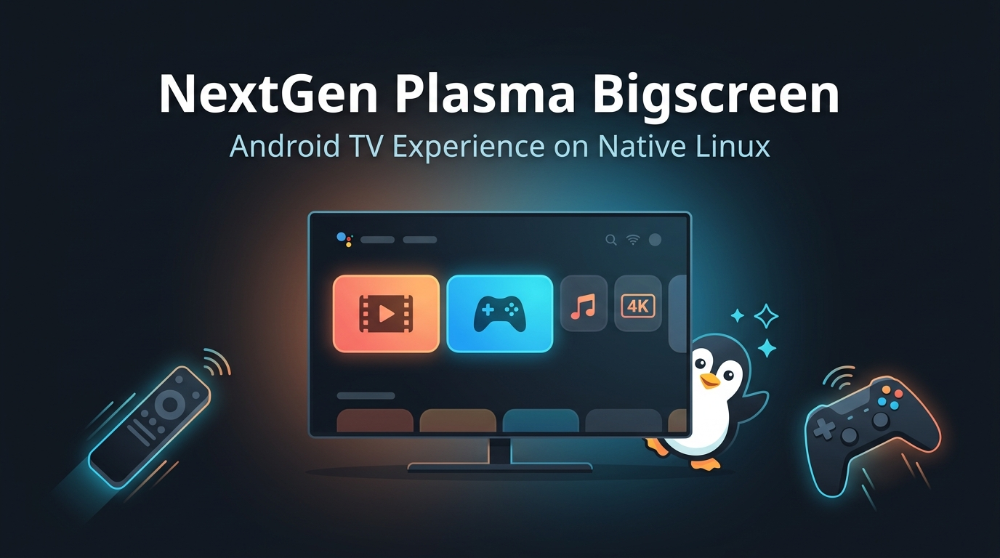

<p align="center">
  
</p>

# NextGen Plasma Bigscreen

**KDE Plasma Bigscreen customized to replicate an Android TV / Google TV experience on native Linux.**

Built for immutable atomic Linux desktops (tested on **Bazzite / Fedora Kinoite 45 with KDE Plasma 6.8.2 Wayland**) without modifying `/usr` or layering OS packages—everything lives declaratively in `$HOME` (`~/.local/`, `~/.config/`, and systemd user services).

---

## Key Features

- **Android TV / Google TV Homescreen Override (`plasma/plasmoids/org.kde.bigscreen.homescreen/`)**
  - Category navigation tabs (`For You`, `Watch Now`, `Apps`, `Games`) with full keyboard, D-Pad, and controller navigation.
  - Dynamic brand-tinted Hero Spotlight Banner with live `● RUNNING` app status and remote action hints.
  - Wide 16:9 **Watch Now** streaming row (`YouTube TV`, `Stremio`, `Jellyfin TV`, `Haruna`), **Continue & Recent** row, and long-press (`Hold OK`) context menu (`Open / Resume`, `Pin / Remove from Favorites`, `Move Left / Right`, `Force Stop`).
  - Curated Favorites (`YouTube TV`, `Stremio`, `Jellyfin TV`, `Steam`, `Haruna`, `Desktop Mode`, `Movie Mode`) and clean app-grid filtering (`applications-blacklistrc`).
- **Automatic Display Mode Manager, Steam 1080p Priority & Movie Mode (`bin/tv-display-mode`)**
  - **Steam Priority:** Automatically locks the TV output (default `DP-1`) to `1920x1080 @ 60Hz` whenever Steam Big Picture or any Steam game child process is active or fullscreen in the foreground.
  - **On-Demand Movie Mode (`bin/tv-movie-mode-toggle`):** Bigscreen launcher tile + shell helpers (`tv-movie`, `tv-toggle`, `tv-4k`, `tv-1080p`) that cleanly toggle between `3840x2160 @ 30Hz` and `1920x1080 @ 60Hz` with Plasma OSD + brief toast banner feedback (`auto_4k_video_switch: false` by default so navigation stays snappy at 60Hz).
  - **KWin 6 Wayland Integration (`kwin/tv-display-mode.js`):** Pushes active/added/minimized window metadata over DBus (`org.nextgen.TvDisplayMode`) and ensures Stremio opens fullscreen by default.
- **Android TV-Style Background Media Auto-Pause**
  - When returning to the Plasma Bigscreen Home screen / shell overlay or switching focus to Steam or another media app, `tv-display-mode` automatically calls MPRIS `Player.Pause()` on any playing background media app.
  - Matches Flatpak apps accurately across `xdg-dbus-proxy` PID boundaries (via PID, shared `app-flatpak-*.scope` cgroups, `DesktopEntry`, and `Identity`) so the focused player is never paused.
  - Ignores OSDs, notifications, transient popups, Polkit auth dialogs, and `fallback`/`init` states, and never calls `Play()` automatically when refocusing a paused app.
- **Hardware Video Acceleration & Streaming App Ergonomics**
  - **Stremio (`stremio/stremio_mpv_shim.c`):** Lightweight `LD_PRELOAD` shim for `libmpv.so` enforcing `config=yes`, `hwdec=auto-safe`, and `hwdec-codecs=all` so embedded libmpv honors VA-API (`stremio/mpv.conf`).
  - **VacuumTube (YouTube TV):** Wayland-first Electron flags with Vulkan disabled (`--use-vulkan=disabled`) to avoid Intel Gen 9.5 VA-API driver crashes.
  - **Jellyfin Desktop & Haruna:** Configured for VA-API hardware decoding out of the box.
- **Controller, Remote Keymap & Desktop <-> Bigscreen Session Swapping**
  - **`bin/tv-session-switch.sh`:** Cleanly swaps between `org.kde.plasma.bigscreen` and standard `org.kde.plasma.desktop` in user-space, preserving custom blacklists and input handler settings across `plasma-bigscreen-envmanager`.
  - **Gamepad Input Isolation (`configs/plasma-bigscreen-inputhandlerrc`):** `AutoSuppressInput=true` prevents double D-pad input when focused inside Steam Big Picture or controller-capable apps (Stremio / VacuumTube).
  - **USB Remote Remapper & DP-to-HDMI CEC Fix (`bin/tv-remote-keymap.py`):** User-space `EVIOCSKEYCODE_V2` remapper for 2.4G USB air-mouse remotes (`620a:0407`) + `--clear` on tunneled `cec-DP-*` adapters to prevent DP-AUX timeouts.

---

## Repository Structure

```text
NextGen_plasmabigscreen/
├── .gitignore
├── LICENSE                                  # GPL-2.0-or-later
├── README.md
├── assets/
│   └── banner.jpg                           # Repository hero banner graphic
├── install.sh                               # Idempotent user-space installer (--help, --dry-run)
├── rollback-tv-setup.sh                     # Full user-space rollback script
├── bin/
│   ├── tv-display-mode                      # Display switcher + Steam priority + MPRIS auto-pause daemon
│   ├── tv-movie-mode-toggle                 # Movie Mode (4K@30) <-> 1080p@60 toggle with OSD/banner
│   ├── tv-session-switch.sh                 # Desktop <-> Plasma Bigscreen user-space switcher
│   ├── tv-remote-keymap.py                  # User-space USB remote evdev keymap + CEC idle helper
│   ├── steamos-add-to-steam                 # Plasma 6 MIME fix for adding wrappers to Steam
│   ├── tv-display-mode.sh                   # Manual kscreen-doctor display helper
│   └── streaming_scripts/                   # Steam Non-Steam wrapper scripts
├── kwin/
│   └── tv-display-mode.js                   # KWin 6 Wayland window state & fullscreen reporter
├── stremio/
│   ├── stremio_mpv_shim.c                   # LD_PRELOAD libmpv shim enabling mpv.conf & hwdec=auto-safe
│   └── mpv.conf
├── mpv/
│   └── tv-display-mode.lua                  # Optional mpv playback resolution hook
├── plasma/
│   └── plasmoids/org.kde.bigscreen.homescreen/  # Customized Android TV homescreen plasmoid
├── systemd/user/
│   ├── tv-display-mode.service
│   ├── tv-remote-keymap.service
│   └── plasma-bigscreen-inputhandler.service
├── configs/                                 # Sanitized config files & @HOME@ templates
├── desktop/                                 # .desktop launchers & @HOME@ templates
├── tests/
│   └── test_tv_display_mode.py              # Unit tests for mode policy, debouncing & auto-pause
└── docs/                                    # Architecture, streaming, remote/CEC, How-To & AI prompts
```

---

## Quick Start

### 1. Preview Installation (`--dry-run`)
```bash
git clone git@github.com:nissifield/NextGen_plasmabigscreen.git
cd NextGen_plasmabigscreen
./install.sh --help
./install.sh --dry-run
```

### 2. Install into `$HOME`
```bash
# Core Plasma Bigscreen UI, display daemon, Movie Mode toggle, Stremio shim & desktop files:
./install.sh

# Optionally include Intel VA-API, WirePlumber HDMI audio, Gamescope & PowerDevil presets:
./install.sh --with-hardware-presets
```

### 3. Configure Your Display Connector (If Not `DP-1`)
Find your connected display output name:
```bash
kscreen-doctor -o
```
Edit `~/.config/tv-display-mode/config.json` and update `"output"` (e.g. `"HDMI-A-1"` or `"DP-1"`), `"mode_4k"`, and `"mode_1080p"`, then restart the service:
```bash
systemctl --user restart tv-display-mode.service
~/.local/bin/tv-display-mode status
```

### 4. Switch Between Bigscreen & Desktop
```bash
~/.local/bin/tv-session-switch.sh bigscreen
~/.local/bin/tv-session-switch.sh desktop
```

---

## Running Tests & Verification

```bash
python3 -m py_compile bin/tv-display-mode tests/test_tv_display_mode.py
python3 tests/test_tv_display_mode.py
gcc -shared -fPIC -O2 stremio/stremio_mpv_shim.c -o /tmp/stremio-mpv-shim-test.so -ldl && rm -f /tmp/stremio-mpv-shim-test.so
bash -n install.sh rollback-tv-setup.sh bin/tv-session-switch.sh bin/tv-display-mode.sh configs/bashrc.d/tv-display-mode.sh
```

---

## Documentation & License

- [Architecture & UI Design](docs/01-Architecture-and-UI-Design.md)
- [Streaming Apps Guide](docs/02-Streaming-Apps-Guide.md)
- [Remote Controls & HDMI-CEC](docs/03-Remote-Controls-and-HDMI-CEC.md)
- [Operations & Rollback Runbook](docs/04-Operations-and-Rollback-Runbook.md)
- [Complete Setup How-To Guide](docs/05-Complete-Setup-HowTo.md)
- [AI Agent & Multi-Model Prompt Library](docs/06-AI-Agent-Prompts.md)
- Licensed under **GPL-2.0-or-later** (see [LICENSE](LICENSE)) in compliance with KDE Plasma Bigscreen QML derivatives.
